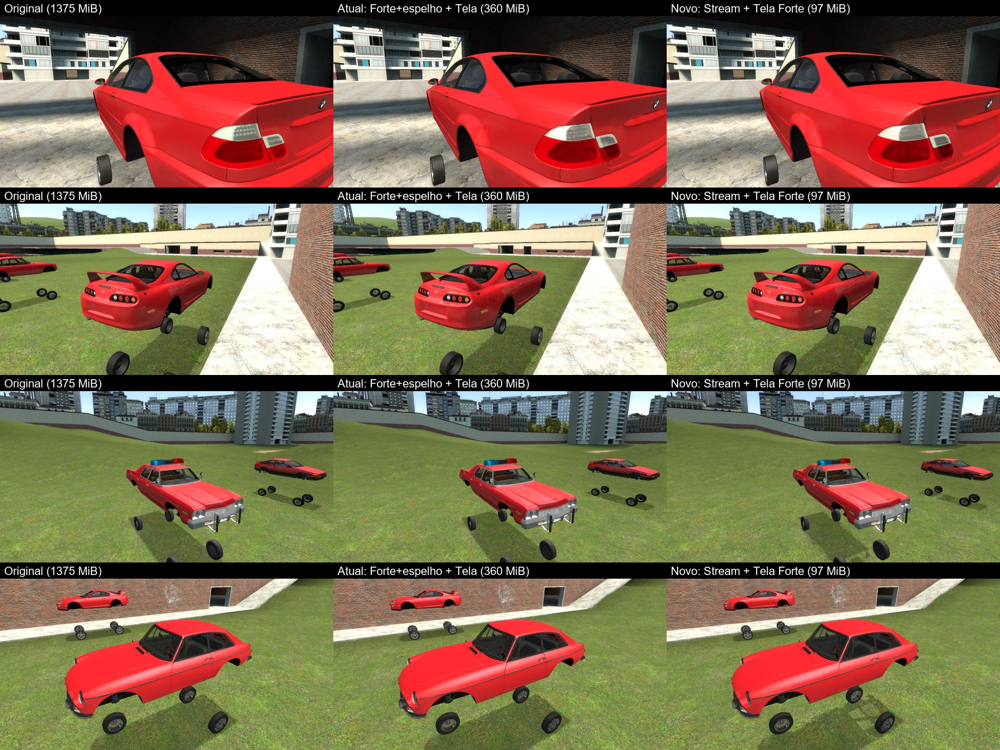

# Modelos em stream + texturas Forte: o pacote LVS em ~100 MB (08/11/2026)

Pedido: o addon `lvs_cars_pack` otimizado estava em 360 MiB (models Forte + espelho 213, texturas
Tela 136, sons 9) e a meta era chegar perto de 100 MB no disco, com a melhor qualidade possível.
Laboratório: `C:\GModLab\night` (scripts, pacotes e capturas). Cliente de teste: `C:\GModLab\runtime`.

## Resultado

| Versão | Disco | FLIP região do carro (dia / noite)* | Quadro com 6 carros (dia / noite)** |
|---|---:|---:|---:|
| Original | 1375 MiB | 0 | 7,5 / 5,9 ms |
| Atual (Forte + espelho + Tela q50 + WAV adaptativo) | 360 MiB | 0,054 / 0,053 | ~8 ms |
| **Stream (geometria original) + Tela Forte (1ª versão)** | **99,7 MiB** | **0,050 / 0,056** | **7,4–7,8 / ~11 ms** |
| Ruído entre duas sessões do original | – | 0,010 | – |

\* `C:\GModLab\night\stream\flipexp.py`: 6 carros LVS reais (E46, Charger, Supra, MGB, Monaco
policial, AE86) spawnados no gm_construct, 4 vistas cada, exposição HDR igualada pelo fundo, FLIP
só na região do carro, contra o pacote original.
\*\* RTX 4060 notebook, medição com ruído de ±1–2 ms entre sessões; "noite" = faróis LVS de 3
carros ligados apontando para os outros.

(Rodas soltas: o teste congela as carrocerias no ar para as poses serem iguais entre sessões.)

O addon gerado pelo produto (Models Tela Stream + texscreen Forte + WAV adaptativo) tem 97,4 MiB
(stream 28,5 · models 17,0 · texturas 42,0 · sons 9,1 · Lua 0,7); pelo botão Comprimir da UI as
texturas ficam em 40,4 MiB (os VTF que caem no caminho Standard também encolhem).

Distribuição dos 99,7 MiB do protótipo: geometria em stream 28,1 · models (malha grossa dos carros, rodas e
models pequenos Forte + espelho, MDL/PHY) 19,7 · texturas 42,1 · sons 9,1 · Lua 0,7.

## A ideia: geometria comprimida desenhada pela Lua

O formato dos models é fixo (VVD 48 bytes por vértice, VTX 9 bytes por vértice + índices) e o motor
não lê nada comprimido. Toda simplificação "com aparência quase igual" esbarra num piso estrutural
(arestas duras, costuras de UV, materiais, faces duplas, peças pequenas). Medido nesta noite:
afrouxar as tolerâncias, colapsar através de costuras (meshoptimizer permissive), distância de
referência 4x maior: 213 → 185 MiB só.

O Garry's Mod deixa a Lua do cliente montar malhas (`Mesh()`/IMesh) e desenhá-las com qualquer
material. Então o addon guarda:

- o `.mdl` original (ossos, bodygroups, attachments, física), com uma **malha grossa (~2%)** no
  VVD/VTX: é o que o motor desenha para a sombra (RTT), longe da câmera (`gmo_stream_far`, 4000),
  enquanto o stream decodifica, e como reserva se a Lua estiver desligada;
- a **geometria original inteira comprimida** em `data_static/gmo/<hash>.txt` (formato GMOS, ver
  `model_stream/encoder.py`);
- `lua/autorun/client/gmo_stream_<addon>.lua`: o runtime (`model_stream/runtime.lua`) com o
  manifesto (model → arquivo).

O runtime substitui `Entity.DrawModel` (as entidades scriptadas como o LVS chamam isso no `Draw`;
props/gibs sem Lua recebem um `RenderOverride` que chama o mesmo caminho). Na primeira vez que um
model aparece, o stream é decodificado em fatias de 4 ms por quadro (0,1–1 s por carro) e vira
IMeshes (triangle strips, até 65535 vértices cada), um grupo por (bodypart, escolha, malha, osso).
Depois disso, a cada quadro:

- **Iluminação idêntica à do motor**: um "probe" de 1 triângulo por entidade
  (`models/gmo_stream/probe_v1.mdl`) é desenhado invisível (sem escrita de cor/profundidade) na
  origem de iluminação do model (`illumposition`). O motor monta para ele o mesmo cubo de ambiente,
  luzes locais e cubemap, e os IMeshes desenhados em seguida usam esse estado. Por entidade porque
  o motor interpola a luz de cada entidade no tempo; com material próprio que usa `$envmap
  env_cubemap`, `$bumpmap` e `$phong`, senão o motor não seleciona o cubemap local (o carro saía
  "lavado", FLIP 0,12).
- **Normais exatas do motor**: o motor manda as normais dos models para a GPU em 2 bytes
  (`PackNormal_UBYTE4`); o stream guarda esses mesmos 2 bytes e a Lua decodifica com a fórmula do
  shader. Com normais "mais precisas" (int8) o reflexo saía diferente (FLIP 0,045 → 0,025).
  As tangentes são recalculadas na Lua (derivadas de UV por triângulo, como o studiomdl; 96–99% iguais
  às do VVD) e passam pelo mesmo empacotamento.
- skins, bodygroups, `SetSubMaterial` (luzes do LVS), `SetMaterial`, cor/alpha da entidade, passe
  opaco e translúcido (refract com `UpdateRefractTexture`), ossos móveis (portas, volante, ponteiros)
  via matriz por osso.
- **Lanternas/faróis**: `render.RenderFlashlights` redesenha para TODAS as luzes ativas; o runtime
  só pede isso quando um ProjectedTexture rastreado (criado pela Lua, ex. faróis do LVS) ou a lanterna
  de um jogador alcança a entidade, e nesses passes desenha só as peças que somam 85% da área (até 24
  desenhos). Antes: 35 ms com faróis ligados; depois: ~11 ms (original 5,9).
- streams sem uso por 5 minutos são liberados da memória de vídeo.

Comandos no console: `gmo_stream 0` desenha só o `.mdl` (comparar/desligar), `gmo_stream_far`,
`gmo_stream_budget_ms`, `gmo_stream_probe 0` (pré-iluminação pelo próprio model, mais lenta).

### Formato GMOS v6 (resumo)

LZMA no formato do `util.Decompress`. Por grupo: posições quantizadas a 1/64 de unidade (erro ≤
0,15 mm), UV a 1/4096 (≤ 1/4 texel de uma textura 2048), normais nos 2 bytes do motor; cada campo
com "back-reference" (mesmo valor de um vértice anterior), delta, zigzag e planos de bytes; índices
das strips com código de "high-water mark". E46 original: 12,5 MB de arquivos → 0,98 MB.
`encoder.decode()` é um decodificador de referência que espelha a Lua (usado nos testes).

### Quais models entram em stream

`model_stream.wants_stream`: models ≥ 400 KB sempre; ≥ 20 KB se o nome não for de roda
(`wheel|tire|tyre|fw|rw|wh`) — rodas aparecem 4 por carro o tempo todo e são baratas como model.
Só models rígidos (≤ 5% de vértices com peso dividido; os poucos vértices com dois ossos, ex. coifa
do câmbio, seguem o osso principal). Os outros usam o Forte + espelho.

## Texturas: perfil Tela "Forte" (`strong`)

`texlab/screen_compress.py`: limiar de perda de detalhe 0,12 (o q50 usa 0,00257) e até 8x pela energia
de detalhe, com dois freios:

- texturas usadas como `$detail` (os atlas de AO "skin" da carroceria do LVS) param em 4x: com 8x os
  blocos DXT apareciam como manchas na lataria branca (Supra);
- **8x só para texturas que nunca aparecem esticadas de perto**: a 96 unidades (~1,8 m), na metade dos
  pixels, a textura reduzida não pode ficar esticada mais que 2^1,5 (~2,8x). Sem isso, a pintura da
  viatura do Monaco (texto "HIGHWAY PATROL", `police_sign_*`, 2048²) ia a 256² e ficava ilegível; agora
  para em 4x (512²), legível. Comparação na porta (2x / 4x / 8x) feita no jogo em 08/11.

LVS: 798 → 51,4 MiB (q50: 136; o Forte da primeira versão: 40,2 com o texto ilegível). FLIP só das
texturas, 8 carros, sonda fixa: q50 0,017 (pior região 0,143), Forte 0,026 (0,165), Forte antigo 0,035
(0,238). O addon completo (stream + Forte + WAV adaptativo) fica com 108,3 MiB.

## No produto

- Models → modo **Tela** → perfil **"Stream (experimental)"** (worker `modscreen --profile stream`;
  `--stream-min-kb`). O padrão continua "Forte + espelho".
- Mídia e recursos → modo **Tela** → **Perfil Tela**: "Equilibrado (q50)" (padrão) ou "Forte (menor)"
  (`texscreen --profile strong`).
- Para o ~100 MB do LVS: Models Tela Stream + Mídia Tela Forte + WAV adaptativo.
- Arquivos: `model_stream/` (encoder, coarse, runtime.lua, probe/), `model_screen/cli.py`,
  `texlab/screen_compress.py`, `pyinstaller/worker.spec`; testes `tests/test_model_stream.py`.

## Limites conhecidos

- Precisa da Lua do cliente (no multiplayer o arquivo vai junto, é `autorun/client`). Sem ela, o
  carro aparece com a malha grossa.
- À noite, com muitos faróis apontados para muitos carros, custa mais que o original (ver tabela).
- Ao aparecer pela primeira vez, o carro fica 0,1–1 s com a malha grossa enquanto decodifica.
- Marcas de tiro (decals) ficam na malha grossa, não aparecem na geometria em stream.
- Vértices com peso dividido entre ossos seguem só o osso principal (diferença só quando o osso
  mexe: coifa do câmbio, molas da suspensão).
- Sons: os loops de motor ainda estão em PCM16 22 kHz (6,6 MiB). ADPCM forçado levaria o pacote a
  ~95 MiB com alguma perda audível — decisão do usuário.
