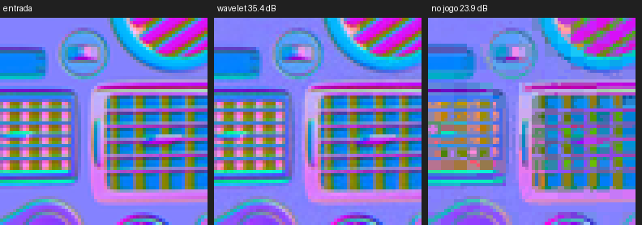
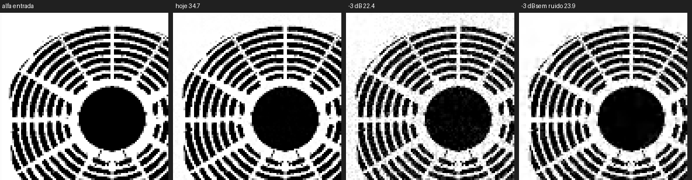
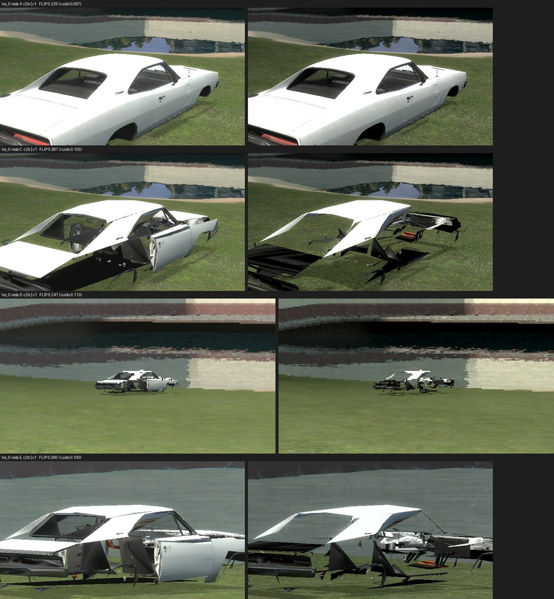
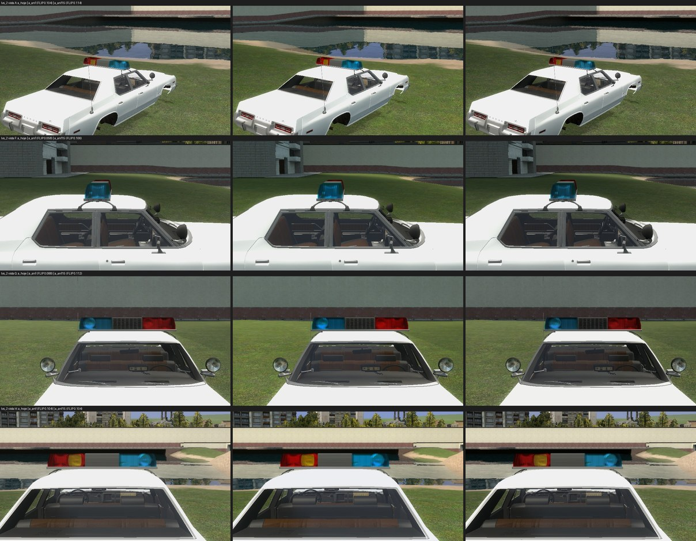

# Revisão dos formatos GMOT e GMOS: quanto falta para o limite (Claude, 20/11/2026)

Fase de análise e protótipo. Nada no produto mudou: o trabalho ficou no branch `review/claude-stream`
(este relatório, as imagens e uma cópia dos scripts em `docs/revisao-stream-claude-2026-11/scripts/`) e no
laboratório `C:\GModLab\revisao\claude\` (scripts em `scripts\`, resultados em `out\`, protótipo em Rust em
`rust\gmotcm\`). Cada número diz se foi **medido** (rodado
na bancada) ou se é **estimativa** (conta, amostra pequena ou literatura).

## Resumo

- **A bancada não está no limite, mas a maior parte do que sobra não está dentro do GMOT nem do GMOS.**
  Dos 318 MiB de modelos, só 107 MiB são GMOS. Os outros 211 MiB são `.mdl` (71 MiB nos models em
  stream, dos quais ~47 MiB são animações), malha grossa (34 MiB), models fora do stream (86 MiB) e
  física (20 MiB). Nas texturas, o GMOT é 85 dos 120 MiB.
- **GMOT, sem perda (mesma imagem no jogo): codificação aritmética com contexto no lugar do LZMA.**
  Medido na bancada inteira, com cada pedaço decodificado de volta e conferido: **−13,1 MiB no
  Custo-benefício (−15,4% dos blobs) e −10,5 MiB no Máximo (−17,3%)**.
  - A conversão no PC fica 5× mais rápida nessa etapa.
  - O custo é decodificar no Lua: o protótipo em LuaJIT soma **+69% ao tempo de decodificação** de
    cada textura. Isso vale só na primeira sessão (da segunda em diante sai do cache) e não mexe no
    FPS, porque o orçamento por quadro é o mesmo; a textura completa chega mais tarde.
  - Alternativa barata, sem custo no Lua: separar o mapa de coeficientes não nulos e manter o LZMA
    nativo, −5,7% (≈ −4,8 MiB, estimativa por amostra).
- **GMOT, alfa: o alfa é 30% dos blobs (25,6 MiB).**
  - Tirar o preenchimento de ruído do canal alfa (muda só o codificador) dá **−1,5% e o alfa fica
    melhor no jogo** (mediana +1,4 dB, nenhuma textura pior).
  - Junto com um alvo 1,5 dB mais baixo para o alfa, a amostra cai **19%** (≈ −14 MiB na bancada,
    estimativa), com o alfa 0,8 dB abaixo de hoje na mediana. É decisão de qualidade, com imagens.
- **GMOT, qualidade:** o alvo de 34 dB é medido antes do preenchimento de ruído e do DXT. O que o jogo
  mostra fica em **33,1 dB na mediana (cor) e 34,8 dB (normal maps)**, com uma cauda até 24 dB.
  - A cauda vem do próprio formato DXT1, não do codificador DXT do Lua: um DXT bem melhor mudou de
    −0,05 a +0,25 dB.
  - Transformada (9/7), grade de passos, zona morta, reconstrução e seleção pelo resultado final ficam
    todas a menos de 4% do que existe na mesma qualidade.
- **Modelos: o maior ganho barato é a malha grossa.** Hoje ela é 2% dos triângulos e custa 33,8 MiB (o VVD
  gasta 48 bytes por vértice, 10× o GMOS). Medido na bancada inteira, só o tamanho: **1% → −13,4 MiB;
  0,5% → −18,7 MiB**. **Testado no jogo à tarde e recusado:** a 1% o carro perde painéis inteiros (ver
  "Atualização").
- **GMOS está perto do limite com ferramentas simples.** Medido na bancada inteira (107 MiB):
  previsão por paralelogramo −3,6% (−3,9 MiB, sem perda); codecs do meshoptimizer **+27%**;
  codificador adaptativo simples pior que o LZMA em todos os campos. O que ainda dá ganho grande está
  fora do arquivo GMOS: a malha grossa (34 MiB), os 34 models mantidos por causa de uma lente (34 MiB),
  as rodas (21 MiB) e as animações (~47 MiB).
- **Régua:** no mesmo PSNR, o AVIF usa **55 a 61% menos bytes** que o GMOT. O JPEG 2000 (OpenJPEG)
  usa 32% mais. O GMOT está bem projetado para um codec decodificável em Lua, e a distância para o
  estado da arte vem de ferramentas (predição intra, transformadas adaptativas, otimização
  taxa-distorção) que custam caro para decodificar em Lua.

**O que fazer primeiro (detalhes na seção 7):**

1. Alfa sem preenchimento de ruído: **feito** (commit `4638f12`, branch `feature/alfa-sem-ruido`).
2. Malha grossa menor: a 1% foi **recusada no jogo**; pede outro simplificador.
3. Decidir o alvo do alfa com as imagens.
4. Escolher entre o codificador com contexto (−13 MiB, decodificação +69%) e o mapa de não nulos com
   LZMA (−5 MiB, sem custo).

## 1. Como medi

**Linha de base (medida).** Rodei as 5 bancadas juntadas pelo worker em Python do commit `f507f07`, o
mesmo código do `publish/2026-03`: `modscreen --profile stream`, depois `texscreen --profile stream`
(Custo-benefício) ou `stream_max` (Máximo) e `pnglossless`, como o assistente monta os comandos
(`SourceAddonOptimizerCommandBuilder.cs`, `ScreenVTFEdit.cs`). Fontes copiadas (cópia real, não hard
link) de `C:\GModLab\bench\src\<grupo>\<grupo>_merged` para `C:\GModLab\revisao\claude\src\`, e cada
saída numa pasta sozinha (`cb\<grupo>\`, `max\<grupo>\`), sem vizinhos. Driver:
`scripts\baseline.py`.

- **Modelos:** batem com a `baseline_mcb14.json` do app publicado. O m9k deu os mesmos 10.469.665
  bytes de stream e 27.631.149 de models; os 5 grupos somam 318,0 MiB, igual à mcb14.
- **Texturas:** 1,1% acima da mcb14 (119,8 contra ~118,5 MiB, sem o runtime Lua, que o app conta em
  "Outros"; os valores da mcb14 estão arredondados a 0,1 MiB por grupo).
- **"Outros":** batem (24,1 MiB).
- **Sons:** o estágio de sons é C# e não rodei. Uso os 266 MiB da mcb14.

**Determinismo (medido):** uma segunda rodada da bancada inteira, com o código de laboratório que grava
a entrada de cada textura (`scripts\dump_inputs.py`, overlay em `C:\GModLab\revisao\claude\code`),
saiu **idêntica byte a byte** nos 5 grupos (0 arquivos diferentes fora os PNG). Essa rodada deu as
4.804 imagens de entrada do codificador usadas nos experimentos com perda.

**Qualidade:** sempre contra a entrada do codificador de stream (a imagem que o Forte entrega), nunca
contra um resultado intermediário. A "qualidade no jogo" é o VTF que o `decoder.lua` monta (espelho
`codec.lua_vtf`, com o DXT do Lua), decodificado de volta. Métricas: PSNR (como o `choose.py`: RGB nas
cores e vetores unitários nas normal maps), SSIM na luminância e FLIP (NVIDIA, `flip-evaluator`, LDR,
67 ppd).

**Tempos:** as rodadas de tamanho correram com outras coisas na máquina (só o resultado importa, que é
determinístico). Os tempos de Lua da seção 3.1 foram refeitos com a máquina livre (nenhum outro
processo pesado, melhor de 3 repetições). A outra revisão (Codex) não tinha criado pasta em
`C:\GModLab\revisao\` nesse momento.

## 2. Inventário (medido, Custo-benefício)

Total equivalente ao app: **728,4 MiB** (modelos 318,5 + texturas 119,8 + sons 266,0 da mcb14 + outros
24,1). Máximo: 704,4 MiB (texturas 95,8; o resto igual).

### Modelos: 318,5 MiB

| Componente | MiB | % dos modelos |
|---|---:|---:|
| GMOS (`data_static/gmo`, 2.156 models) | 107,2 | 34% |
| `.mdl` dos models em stream | 71,0 | 22% |
| … dos quais animações (atribuição pelo intervalo de seções do cabeçalho) | ~47,0 | ~15% |
| Malha grossa dos models em stream (`.vvd` 25,2 + `.vtx` 8,6) | 33,8 | 11% |
| Models fora do stream (`.mdl` 11,8 + `.vvd` 59,7 + `.vtx` 14,2) | 85,6 | 27% |
| Física `.phy` (em stream 13,0, outros 7,4) | 20,4 | 6% |
| Runtime GMOS (Lua) + probe | 0,5 | – |

Por que os models ficam fora do stream (bytes depois da otimização):

| Motivo | Models | MiB | Vértices originais |
|---|---:|---:|---:|
| Mantidos como o autor fez (lente/mira com render target ou proxy de Lua) | 34 | 34,8 | 408.698, todos rígidos |
| Rodas (nome com wheel, tire, tyre; `fw`, `rw`, `wh`) | 390 | 21,3 | 388.828 |
| Skinning (> 5% dos vértices com peso) | 48 | 19,8 | 381.589 |
| Pequenos (< 20 KB) | 1.317 | 11,6 | 143.013 |
| Sem triângulos / outros | 34 | 0,9 | – |

GMOS por campo (cada campo comprimido sozinho com LZMA 9e; o arquivo real é um fluxo só e fica 4%
menor que a soma): posições 35,4 MiB (33%), referências "mesmo valor que o vértice k para trás"
(`pref`/`nref`/`uvref`) 29,2 (27%), UV 20,6 (19%), normais 14,3 (13%), índices das strips 10,6 (10%),
cabeçalho 1,0. São 23,1 milhões de vértices e 23,7 milhões de triângulos: **4,74 bytes por
triângulo**.

### Texturas: 119,8 MiB (+1,5 do runtime Lua)

| Componente | MiB |
|---|---:|
| GMOT (`data_static/gmot`, 4.804 blobs) | 84,7 |
| PNG/JPG (já com PNG sem perda) | 23,0 |
| VTF que continuam VTF (fora de DXT, animadas, < 64 px, presas ao tamanho no mapa) | 7,8 |
| Placeholders de 16 px | 2,4 |
| VMT | 2,0 |

GMOT por parte (pedaço 0 = cabeçalho + pirâmide até 512 px; dividido pelo tamanho LZMA de cada banda,
escalado ao tamanho real do pedaço):

| | Pedaço 0 | Níveis finos | Total | % |
|---|---:|---:|---:|---:|
| Cor: luminância Y | 29,1 | 9,0 | 38,0 | 45% |
| Cor: croma Co + Cg | 9,0 | 1,5 | 10,5 | 12% |
| Cor: alfa | 12,4 | 9,6 | 22,0 | 26% |
| Normal: X + Y | 7,8 | 2,5 | 10,3 | 12% |
| Normal: alfa | 2,4 | 1,3 | 3,7 | 4% |

- Por tamanho: as 486 texturas de 1024 são 48% dos bytes, as 1.015 de 512 são 23%, as 1.703 de 256
  são 15% e as 38 de 2048 são 10%.
- Pedaços: 10.651, dos quais 2.749 são triviais (banda toda zero). O contêiner custa 0,07 MiB e o
  cabeçalho VTF dentro do pedaço 0, 0,96 MiB antes do LZMA.
- **O alfa é 30% do GMOT (25,6 MiB).**

### Sons e outros

Sons 266 MiB (mcb14). Outros 24,1 MiB, dos quais **Lua dos addons 18,6 MiB** e os dois runtimes 2,0 MiB.

## 3. GMOT

### 3.1 Codificação dos coeficientes: contexto + codificação aritmética (medido)

**O que é.** Mesmos coeficientes quantizados e mesmos mapas de ruído do GMOT v2; muda só a camada que
guarda os bits. No lugar do LZMA de cada pedaço entra um codificador aritmético binário adaptativo
(o mesmo esquema de range coder do LZMA; probabilidades de 12 bits, adaptação 1/16). Para cada pedaço:

- um modelo novo (os pedaços continuam independentes: prévia, metade e completa como hoje);
- por banda, uma flag "tem algum coeficiente não nulo" por bloco 8×8, com o contexto das flags da
  esquerda e de cima;
- dentro dos blocos não nulos, "é zero?" com o contexto da vizinhança já decodificada
  (2·esquerda + 2·cima + diagonais + dois para trás, em 8 classes);
- sinal com o contexto dos sinais da esquerda e de cima;
- magnitude em unário até 14 (contexto: posição × vizinhança), depois Exp-Golomb;
- banda LL com predição MED (LOCO-I);
- mapa de ruído com o contexto do código anterior.

Protótipo: `rust\gmotcm` (codificador e decodificador; toda chamada decodifica de volta e compara),
`scripts\cm_real.py`; decodificador Lua em `scripts\cm_decoder3.lua`.

**Tamanho (medido, bancada inteira, conferido coeficiente a coeficiente):**

| Perfil | GMOT hoje | Com o codificador | Ganho |
|---|---:|---:|---:|
| Custo-benefício | 84,66 MiB | 71,61 MiB | **−13,05 MiB (−15,4%)** |
| Máximo | 60,91 MiB | 50,37 MiB | **−10,54 MiB (−17,3%)** |

Na bancada inteira: Custo-benefício 728,4 → 715,3 MiB (−1,8%); texturas 119,8 → 106,8 MiB (−10,9%).
O pedaço 0 (muitas bandas pequenas) ganha 12%; os níveis finos, 24%.

**Antes da implementação, a estimativa e as variantes (amostra m9k de 200 blobs, estimador KT, fórmula
fechada pelas contagens):**

| Modelo | Mudança |
|---|---:|
| Ordem 0, sem contexto | +3,9% (pior que o LZMA) |
| Vizinhos esquerda/cima | −14,7% |
| 6 vizinhos | −16,3% |
| 6 vizinhos + coeficiente pai | −18,4% |

O codificador real superou a estimativa (−19,8% na mesma amostra), por adaptar mais rápido do que o
estimador e pelas flags de bloco. O coeficiente "pai" daria mais ~2 pontos, mas exige guardar a banda
do nível anterior no decodificador (memória do Lua): ficou de fora.

Configurações do codificador real (mesma amostra):

| Configuração | Mudança |
|---|---:|
| Probabilidades de 12 bits, adaptação 1/16, flags 8×8, contexto de sinal | −19,8% |
| Adaptação 1/32 | −19,7% |
| Sem flags de bloco | −19,0% |
| Sinal sem contexto | −17,0% |
| Probabilidades de 16 bits | −19,2% |

**Probabilidades iniciais treinadas na bancada** (o "contexto compartilhado entre texturas", uma tabela
fixa no decodificador, igual para todo addon): treinadas na metade par dos blobs e medidas na metade
ímpar, **−0,3%** (−2,1% nas de 64 px, −0,2% nas de 1024). Não vale: o modelo adaptativo aprende
quase de graça.

**Reorganizar os bytes e manter o LZMA nativo** (alternativa que não custa Lua; `scripts\lzma_variants.py`):

| Variante | m9k (120 blobs) | LVS (120) | Bancada (800 espalhados) |
|---|---:|---:|---:|
| `lc=4` | +0,2% | +0,1% | +0,0% |
| zigzag | −1,2% | −0,8% | −0,7% |
| mapa de não nulos em bits + valores à parte | **−6,6%** | **−3,6%** | **−5,7%** |
| banda transposta | +1,5% | +1,4% | +1,6% |

- Ganho na bancada: ≈ −4,8 MiB no Custo-benefício (estimativa: 5,7% da amostra aplicado aos 84,7 MiB).
- É um terço do ganho do codificador com contexto.
- A decodificação fica praticamente de graça: o mapa é desempacotado no Lua (um byte lido a cada 8
  coeficientes, contra um por coeficiente hoje) e o resto continua no `util.Decompress` nativo.

**Decodificação no LuaJIT (medida, lupa/LuaJIT 2.1).** O decodificador Lua dá exatamente os mesmos
coeficientes (conferido banda a banda em 16 texturas do LVS e nas texturas testadas antes). Tempos
com a máquina livre, melhor de 3 (JIT aquecido, como no jogo depois das primeiras texturas), em 40
texturas (as 20 maiores da bancada e 20 espalhadas; `out\cmlua_cb.json`):

| | Hoje: decodificação inteira (`GMOT.Decode`) | LZMA dos pedaços (dentro do de hoje) | Bandas no Lua (protótipo) | Mudança |
|---|---:|---:|---:|---:|
| 40 texturas | 8,54 s | 0,78 s | 6,63 s | **+69%** |
| Só as 25 de 1024 e 2048 | 8,13 s | 0,76 s | 6,39 s | +69% |
| Frio (primeira chamada, JIT sem aquecer) | 9,06 s | – | 6,97 s | +68% |

- Velocidade: 18,4 milhões de coeficientes por segundo na média; de 20 a 60 milhões nas bandas
  grandes, menos nas bandas com alfa e ruído.
- Numa textura de 2048: hoje 0,55 a 0,79 s, mais 0,19 a 0,42 s.
- Dentro da decodificação de hoje, 75% do tempo é a etapa DXT (que inclui a síntese do último nível)
  e 22% os níveis anteriores da wavelet.
- No jogo, o orçamento por quadro (`gmot_budget`, 6 ms, fatias com `Y()`) segura o FPS. O efeito é a
  textura completa chegar mais tarde na primeira sessão (estimativa: uma arma ARC9 que fica completa
  em ~7 s passaria a ~12 s). Da segunda sessão em diante não muda nada, porque as texturas saem do
  cache já em DXT.

Notas do protótipo de Lua:

- A primeira versão era 2× mais lenta por fechamentos (closures) que capturavam o estado do
  codificador. O LuaJIT também abortava traces com o erro 34 ("register coalescing too complex") e,
  com abortos repetidos, coloca o laço na lista negra e ele volta a rodar interpretado.
- A versão final separa o caminho raro (sinal e magnitude) numa função e reaproveita um buffer com
  borda de zeros entre bandas (alocar duas tabelas de 1 milhão de posições custava 63 ms).
- Ainda há abortos. Uma versão de produto precisaria de mais trabalho de JIT, por exemplo decodificar
  significância e valores em passadas separadas por linha.
- Memória: o buffer de uma banda 1024² são ~1 milhão de números no Lua (~8 MB), reaproveitado.

**Custo no PC (medido, 302 blobs do LVS, 59 MiB de bandas):** o codificador em Rust (codificação +
decodificação de conferência) roda a **19,3 MiB/s**; o LZMA 9 `pb=0` do produto, nas mesmas bandas, a
**3,7 MiB/s**. O LZMA final era mais da metade da conversão do stream (`docs/velocidade-2026-11-10.md`):
com o codificador novo, essa etapa fica ~5× mais rápida.

**Compatibilidade e esforço:**

- Formato novo (GMOT v3) com `CORE_VERSION` 4. O decodificador novo lê v2 e v3, e os addons convertidos
  antes continuam funcionando.
- O caminho de decodificação muda (`util.Decompress` sai dos pedaços de banda). Os testes
  `test_texture_stream.py` precisam de casos v3.
- O runtime precisa de um ritmo de fatias que considere a decodificação de entropia (cada banda pode
  levar dezenas de ms; hoje o `Y()` já é chamado por linha).
- Esforço médio a alto: Rust do codificador pronto no laboratório, decodificador Lua em protótipo,
  integração com o runtime e o cache.

### 3.2 Qualidade final, margem e seleção do passo (medido)

Amostra de 1.200 texturas da bancada inteira (`scripts\texeval.py`, `out\texeval_all_1200.json`):

| | Wavelet com ruído (mediana) | No jogo, depois do DXT do Lua | Perda do DXT |
|---|---:|---:|---:|
| Cor (n=982) | 34,32 dB | **33,09 dB** (p10 30,61; pior 23,86) | 0,77 dB (p90 3,98) |
| Normal (n=218) | 36,06 dB | **34,82 dB** (p10 30,31; pior 25,92) | **2,50 dB** (p90 8,79) |

- SSIM (cor): 0,920 na mediana (p10 0,822). FLIP (cor): 0,055 na mediana (p90 0,076).
- O `choose.py` busca o passo com PSNR ≥ 34 + 1,2 dB **sem** o preenchimento de ruído e **antes** do DXT.
  O ruído tira ~1 dB (a granulação volta e o PSNR cai; é a troca escolhida em 09/11) e o DXT tira
  0,8 dB na mediana.
- A margem de 1,2 dB está bem calibrada para a mediana da cor. Ela não protege a cauda: 10% das
  texturas ficam abaixo de 30,6 dB no jogo, e não é falta de bits na wavelet (elas estão a 35 dB antes
  do DXT).

**Piores casos** (imagens em `docs/revisao-stream-claude-2026-11/`, ampliadas 4×):

- `hoje_1_int_nm.png`: normal map com grades coloridas (Nissan Skyline do simfphys). Ela foi tratada
  como cor e tem 35,4 dB antes do DXT e 23,9 dB no jogo. Um bloco 4×4 com 4 cores que não estão numa
  reta não cabe no DXT1. Isso também aconteceria com o VTF do Forte sem stream (o nvDXT do VTFCmd tem
  o mesmo limite).
- `hoje_2_cork_spec.png`: 24,6 dB de PSNR, mas visualmente quase igual (SSIM 0,965). O PSNR é severo
  com textura de ruído; é um bom exemplo para escolher métricas.
- `hoje_3_rail_normal.png` e `hoje_4_*.png`: outros dois casos (uma normal map da ARC9 e uma textura
  típica, na mediana).

**Um DXT melhor no runtime não resolve (medido).** Com os mesmos blobs, troquei o DXT do Lua por um
DXT1 bem mais forte (eixo PCA, 3 passadas de mínimos quadrados, seletor pela cor mais próxima;
`scripts\dxt_gain.py`):

| | Mudança no PSNR final (mediana) |
|---|---:|
| 40 piores, cor | +0,08 dB |
| 40 piores, normal | +0,25 dB |
| 200 aleatórias, cor | −0,05 dB |
| 200 aleatórias, normal | +0,01 dB |

O codificador do Lua já está perto do que o formato permite: **não vale**.

**Escolher o passo olhando a imagem final (medido, 240 texturas, `scripts\texexp.py`):**

| Política | Tamanho | Cor no jogo (p10 / mediana) | Normal no jogo (p10 / mediana) |
|---|---:|---:|---:|
| Hoje | 5,67 MiB | 30,46 / 33,05 dB | 30,81 / 34,70 dB |
| Mesmo PSNR final de hoje em cada textura, passo numa grade fina contra o resultado depois do DXT (`fin`) | +0,1% | – / 33,16 | – / 34,82 |
| Piso de 33 dB no jogo em toda textura (`fin33`) | **+6,1%** (cor +11,2%, normal −18,6%) | **31,61** / 33,11 | 31,54 / 33,20 |

- **`fin`:** a seleção de hoje (passo + margem) já é eficiente. Medir depois do DXT, com a mesma
  qualidade, não economiza nada.
- **Piso de 33 dB:** dá qualidade mais uniforme. As cores abaixo de 32,5 dB passam de 65 para 27 em 182.
  Em troca, as normal maps, que hoje ficam 1,6 dB acima da cor, descem para perto dela.
- Quando nem o menor passo alcança o piso (o limite do DXT1), a regra mira 0,3 dB abaixo do melhor
  possível.
- Essas duas são opções de política, não ganho de graça. Uma métrica perceptual (SSIM/FLIP) no lugar
  do PSNR também mudaria a cauda: a `cork_spec` está a 24,6 dB e parece igual.

### 3.3 Transformada e quantização (medido)

Amostra de 240 texturas espalhadas pela bancada inteira (uma a cada ~20, `scripts\texexp.py`). Cada variante roda o `choose()` +
`encode()` do produto (caminho numpy de referência) com uma peça trocada e é medida no jogo. A variante
`prod` reproduz exatamente os blobs atuais (5,67 MiB). Para comparar na mesma qualidade, a inclinação
medida é de **~17% de bytes por dB** (mediana por textura).

| Variante | Tamanho | PSNR final cor (mediana) | Leitura |
|---|---:|---:|---|
| prod | 5,67 MiB | 33,05 dB | – |
| Grade de passos fina (2^(1/8), em vez de 19 passos) | −3,7% | 32,78 (−0,27) | ≈ 0 na mesma qualidade: só chega mais perto do alvo |
| Wavelet CDF 9/7 (lifting, mesma escala ortonormal) | **−3,5%** | 33,09 (+0,04) | ganho real, mas o SSIM cai 0,003 na mediana e a síntese no Lua tem o dobro de passos (estimativa: +30 a 45% de decodificação) |
| Zerar ±1 isolado (só no codificador) | +0,2% | 32,92 (−0,13) | pior |
| Passo escolhido na imagem final, mesma qualidade (`fin`) | +0,1% | 33,16 (+0,11) | ≈ −2% na mesma qualidade |

Teste curto (9 texturas, `out\texexp_*_9.json`) que não fui adiante:

- reconstrução deslocada para zero (`(|q| − 0,12)·passo`, no decodificador): mesmo tamanho, −0,1 dB;
- zona morta 0,30 no lugar de 0,40: +1,3% e −0,45 dB.

O quantizador atual (arredondamento 0,4, reconstrução no centro) já está bem ajustado.

### 3.4 Alfa (medido)

`scripts\alpha_study.py` sobre todas as texturas com alfa mantido:

| Uso do alfa | Texturas | Bytes do alfa | Binário (mediana) |
|---|---:|---:|---:|
| Só recorte (`$alphatest`, sem translúcido, alpha-to-coverage, máscaras...) | 86 | 0,60 MiB | 97% dos pixels em 0 ou 255 |
| Outros usos (translúcido, máscara de brilho/reflexo, autoiluminação, parâmetro não modelado) | 1.716 | 19,47 MiB | 78% |
| Nenhum VMT cita a textura (alfa mantido inteiro por segurança) | 87 | 5,56 MiB | 45% |

- **Máscara exata para os recortes:** 0,11 MiB no lugar de 0,60 (−0,5 MiB) e borda idêntica ao original.
  Hoje 0,17% dos pixels mudam de lado do limiar (p90 0,83%). Ganho pequeno: só vale se vier junto com
  outra mudança de formato.
- As 87 texturas sem VMT gastam 70% dos bytes no alfa (5,6 de 8,0 MiB). Elas são HUD/ícones/Lua, e o
  alvo do alfa delas é o mais alto (peso 1).
- **Preenchimento de ruído e alvo do alfa (medido, 240 texturas, 108 com alfa).** O alfa recebe o mesmo
  preenchimento de ruído dos dois níveis finos que a luminância. Em máscara (de brilho, de recorte,
  translúcida) isso vira pontilhado: veja a grade do ventilador abaixo.

| Variante (só o alfa muda) | Tamanho da amostra | Alfa no jogo: mediana / p10 (hoje 33,68 / 30,15 dB) | Pior que hoje |
|---|---:|---:|---:|
| **Sem preenchimento de ruído, mesmo alvo** (`anf`) | **−1,5%** | **35,09 / 32,22** | **nenhuma** (> 3 dB) |
| Sem ruído, alvo −1,5 dB (`anf1.5`) | −19,0% | 32,91 / 27,94 | 32 de 108 (> 2 dB) |
| Sem ruído, alvo −3 dB (`anf3`) | −19,3% | 32,50 / 27,68 | 24 de 108 (> 3 dB) |
| Com ruído, alvo −3 dB (`alpha3`) | −17,8% | 30,83 / 25,88 | 39 de 108 (> 3 dB) |

  - Tirar o ruído do alfa é ganho dos dois lados. É mudança só do codificador: o `decoder.lua` já lê
    bandas sem mapa de ruído, então não muda `CORE_VERSION` e os addons antigos não são afetados.
    Estimativa na bancada: ≈ −1,1 MiB.
  - Baixar o alvo do alfa economiza muito (≈ −14 MiB na bancada, estimativa: a amostra escalada pela
    fatia de bytes com alfa, 63% do GMOT na bancada e 73% na amostra). O ganho satura logo, porque
    muitos alfas já chegam ao maior passo da tabela (66). Custa ~0,8 dB de alfa na mediana. Decisão do
    Luis, com o jogo: o efeito depende do uso (borda de recorte, máscara de brilho, vidro).

### 3.5 Régua: o estado da arte no mesmo erro (medido)

`scripts\refcodec.py`, 145 texturas de cor sem alfa: para cada uma, o menor arquivo que alcança o mesmo
PSNR da reconstrução wavelet do GMOT (W0, mediana 33,95 dB):

| Codec | Bytes contra o GMOT |
|---|---:|
| JPEG 2000 (OpenJPEG, 9/7, busca na taxa) | **+31,6%** |
| AVIF 4:2:0 (libavif/aom, velocidade 4) | **−54,6%** |
| AVIF 4:4:4 | −60,9% |

- O GMOT já está melhor que um JPEG 2000 comum.
- O AVIF mostra que ainda cabe ~2,2× no mesmo PSNR. As ferramentas que fazem essa diferença são predição
  intra direcional, transformadas de vários tamanhos, otimização taxa-distorção, filtros pós-decodificação
  e codificação de entropia com contexto. Só a última foi para o protótipo (−15 a −17%). As outras pedem
  um decodificador várias vezes mais pesado que o atual no Lua.
- Ressalva: o PSNR pune o preenchimento de ruído do GMOT, que melhora a aparência. Na métrica
  perceptual a distância é menor (estimativa).

## 4. GMOS

### 4.1 Recodificação do arquivo (medido, bancada inteira, 107,18 MiB)

`scripts\gmos_exp.py`; leitor vetorizado conferido contra `model_stream.encoder.decode`.

| Variante | Perda? | MiB | Mudança |
|---|---|---:|---:|
| Paralelogramo da strip para posições novas | não | 104,65 | −2,4% |
| + paralelogramo para UV | não | 103,33 | **−3,6%** |
| + normais previstas pelas faces (resíduo no código de 2 bytes) | não | 104,11 | −2,9% (piora) |
| meshoptimizer `encode_vertex_buffer` + `encode_index_sequence` + LZMA | não | 136,30 | **+27,2%** |
| Posições a 1/32 de unidade | sim | 103,24 | −3,7% |
| Posições a 1/16 | sim | 99,38 | −7,3% |
| UV a 1/2048 | sim | 104,85 | −2,2% |

- Codificador adaptativo simples (ordem 0/1, por campo; amostra de 100 blobs do m9k): **pior que o
  LZMA em todos os campos** (5,55 contra 4,96 MiB). O LZMA aproveita repetições, e as referências e os
  índices são cheios delas.
- Outras formas de codificar as referências para trás (distância em valores, gêmeo na janela da
  strip): 1,71 a 1,73 MiB contra 1,71 hoje. Nada.
- Só 0,2% dos vértices são duplicatas exatas (mesma posição, normal e UV no mesmo grupo).
- Quantização: 1/16 de unidade é até 0,03 unidade de erro, ~2 pixels num viewmodel a 1080p. Só serviria
  para models do mundo (estimativa: −5 a −7 MiB só neles, a confirmar no jogo).
- **Decodificação hoje (medida, runtime do produto no LuaJIT com a API de malha simulada):** 0,30 a 0,54
  s por model grande (0,9 a 1,6 MB de stream), ~1/3 no LZMA, em fatias de 4 ms. O paralelogramo obriga a
  decodificar as posições na ordem da strip (estimativa: +10 a 20% nesse tempo).

### 4.2 O que fica fora do stream (medido + estimativas)

| Item | Hoje | Proposta | Ganho | Base |
|---|---:|---|---:|---|
| Malha grossa de 2% (sombra, longe, enquanto decodifica, reserva) | 33,8 MiB | 1% / 0,5% | **−13,4 / −18,7 MiB** | **medido** (estágio de modelos da bancada inteira, `scripts\coarse_test.py`) |
| 34 models mantidos por uma lente/mira (rígidos, 409 mil vértices) | 34,8 MiB | stream parcial: só as malhas com material de tempo de execução ficam no `.mdl` | ~−25 a −29 MiB (GMOS ~4,9 B/vértice) | estimativa |
| Rodas (390 models) | 21,3 MiB | GMOS | ~−15 MiB | estimativa |
| Models com skinning (48) | 19,8 MiB | – | – | – |
| Animações nos `.mdl` | ~47 MiB (só os models em stream) | redução de quadros-chave com erro limitado | estimativa típica de 30 a 60% dos dados de animação | estimativa |

- **Malha grossa:** a 1% ela cai de 33,8 para 20,3 MiB; a 0,5%, para 15,1 MiB. Abaixo disso quase não
  desce: toda malha mantém pelo menos um triângulo, e o simfphys tem 934 models em stream com muitas
  peças pequenas (10,2 → 9,1 MiB). A malha grossa custa 48 bytes por vértice no VVD, contra 4,9 no
  GMOS: é 10× menos eficiente por vértice. O que muda na tela: a sombra projetada (RTT), o model
  além de `gmo_stream_far` (4000), os 0,1 a 1 s antes do stream ficar pronto e a reserva sem Lua.
  O tamanho foi medido; a aparência precisa de teste no jogo.
- **Models mantidos:** pede o runtime desenhar o stream e deixar o motor desenhar só as malhas de lente,
  com cuidado com proxies e render targets.
- **Rodas:** mais desenhos IMesh por carro; pede medir FPS (a regra de hoje existe por isso).
- **Skinning:** IMesh não tem skinning; fica fora.
- **Animações:** formato do motor (RLE por canal). É trabalho fora do GMOT/GMOS, de risco (precisão das
  animações de arma), mas é o maior bloco de modelos depois do GMOS.

### 4.3 Custo no jogo

Não abri o jogo nesta revisão: nenhuma proposta medida aqui muda o desenho, e a sessão das tarefas do
TTT usa o mesmo cliente. Os números de desenho e FPS dos docs de 08/11 continuam valendo (dia ≈ original,
noite +3 ms com faróis; `docs/modelos-stream-2026-11-08.md`). As propostas de rodas e de stream parcial
pedem um tour antes.

## 5. Ranking

Ganho no Custo-benefício (728,4 MiB). "Medido" = rodado na bancada inteira; "amostra" = medido numa
amostra e escalado; "estimativa" = conta. Ordenado pelo que entrega por risco e esforço.

| # | Ideia | Ganho | Qualidade | Custo no jogo | Esforço / risco | Base |
|---|---|---:|---|---|---|---|
| 1 | Alfa sem preenchimento de ruído (só o codificador) | ≈ −1,1 MiB | **melhor** (alfa +1,4 dB na mediana) | nenhum | mínimo; sem mudar o runtime | amostra |
| 2 | Malha grossa 2% → 1% (0,5%) — **recusada no jogo** | **−13,44 MiB** (−18,72) | painéis somem longe, com mira e no primeiro instante | menos dados para carregar | mínimo (`COARSE_RATIO`); risco visual baixo | medido (tamanho) |
| 3 | Alvo do alfa −1,5 dB, sem ruído | ≈ −14 MiB | alfa −0,8 dB na mediana | nenhum | mínimo; decisão de qualidade | amostra |
| 4a | GMOT: codificador aritmético com contexto | **−13,05 MiB** (Máximo −10,54) | idêntica | decodificação +69% na 1ª sessão; conversão 5× mais rápida | médio a alto; GMOT v3 + `CORE_VERSION` 4 | medido |
| 4b | GMOT: mapa de não nulos + LZMA (alternativa a 4a) | ≈ −4,8 MiB | idêntica | ≈ nenhum | baixo a médio; GMOT v3 | amostra (800 blobs) |
| 5 | Stream parcial dos 34 models mantidos por lente/mira | ≈ −25 a −29 MiB | igual, se as lentes ficarem com o motor | mais um desenho por arma | alto; proxies e render target | estimativa |
| 6 | Rodas no GMOS | ≈ −15 MiB | igual | mais desenhos IMesh por carro: medir FPS | médio | estimativa |
| 7 | Animações dos `.mdl` (redução de quadros com erro limitado) | ≈ −14 a −28 MiB (de ~47) | perda nas animações | nenhum | alto; fora do GMOT/GMOS | estimativa |
| 8 | GMOS: paralelogramo para posição e UV | **−3,85 MiB** | idêntica | estimativa +10 a 20% na decodificação do GMOS | médio; GMOS v7 + `REVISION` | medido |
| 9 | Placeholders de 8 px sem miniatura no cabeçalho; runtime Lua minificado | ≈ −1,5 a −2 MiB | primeiros instantes mais borrados | nenhum | baixo | estimativa |
| 10 | Piso de 33 dB no jogo por textura | +6% do GMOT (≈ +5 MiB) | cauda melhor (p10 30,5 → 31,6) | nenhum | baixo; decisão de política | amostra |

**Somando o que é compatível entre si** (cada linha muda uma parte diferente; as do alfa e a 4a se
somam quase em porcentagem):

- Só o medido na bancada inteira (2 + 4a + 8): **−30,3 MiB** (728,4 → 698,1 MiB, −4,2%), sem mudar a
  imagem das texturas.
- Com as opções de alfa e a malha a 0,5%: ≈ −50 MiB.
- Com as estimativas grandes de modelos (5, 6, 7): ≈ −100 a −120 MiB.

**Não vale a pena (medido):**

| Ideia | Número |
|---|---|
| DXT melhor no runtime | −0,05 a +0,25 dB na mesma textura |
| Probabilidades iniciais / contexto compartilhado entre texturas | −0,3% |
| Codecs do meshoptimizer no GMOS | +27% |
| Codificador adaptativo simples no GMOS | +12% pior que o LZMA |
| Outras codificações das referências do GMOS | 0% |
| Normais previstas pela geometria | +0,7% pior |
| Zona morta 0,30 | +1,3% e −0,45 dB (9 texturas) |
| Reconstrução deslocada | −0,1 dB (9 texturas) |
| Zerar ±1 isolado | +0,2% e −0,13 dB |
| Grade de passos fina | ≈ 0 na mesma qualidade |
| Passo escolhido na imagem final, mesma qualidade | +0,1% |
| `lc=4` / zigzag / banda transposta no LZMA | +0,0 / −0,7 / +1,6% |
| Máscara binária exata para recortes | −0,5 MiB |
| Wavelet 9/7 | −3,5% por +30 a 45% de decodificação (estimativa) |

## 6. Distância do teto

**GMOT, camada de bits (sem perda):**

- Hoje o LZMA fica 15 a 17% acima do codificador com contexto que medi.
- A estimativa KT com o coeficiente pai, mais contextos mais ricos (árvores de contexto como as do
  JPEG XL, ou mistura de modelos), indica mais 3 a 6 pontos.
- O teto da camada de bits para os coeficientes de hoje é ~20 a 22% abaixo do atual. O protótipo pega
  ~3/4 disso.

**GMOT, codec inteiro (com perda):**

- No mesmo PSNR, o AVIF usa 55 a 61% menos bytes. O GMOT está a ~2,2–2,6× do estado da arte, e a
  ~1,9–2,2× com o codificador com contexto.
- O que falta são ferramentas de predição, transformada adaptativa e otimização taxa-distorção. O
  ajuste fino do que existe (9/7, quantização, seleção) dá menos de 4%.
- Na forma atual (wavelet + DXT no Lua), o GMOT está perto do limite: o que sobra pede um codec
  diferente, com decodificação várias vezes mais cara no Lua.
- **O DXT no fim** custa 0,8 dB (cor) e 2,5 dB (normais) na mediana. Nenhum codificador DXT recupera
  isso: é o teto do formato que o jogo usa na VRAM.

**GMOS:**

- 4,74 bytes por triângulo com tudo (posição, normal do motor, UV, conectividade).
- As melhorias simples medidas ficam abaixo de 4%.
- Um codec de conectividade e atributos com costuras (classe Draco/Edgebreaker) deve dar 10 a 25%
  (estimativa da literatura). Exige percorrer a malha no Lua, com custo de decodificação ainda não
  medido.
- O GMOS está perto do limite com ferramentas simples. A folga grande dos modelos está **fora** dele:
  malha grossa, models mantidos, rodas e animações somam ~137 MiB, contra 107 do GMOS.

## 7. Recomendação

1. **Alfa sem preenchimento de ruído.** Mudança de uma linha no codificador, alfa melhor e um pouco
   menor, sem tocar no runtime. Pede só rodar a bancada inteira de novo para medir.
2. ~~Malha grossa a 1%~~: testada no jogo e recusada (seção "Atualização"). O caminho é um simplificador
   novo para a malha grossa, com orçamento por model e silhueta preservada.
3. **Mostrar ao Luis as imagens do alvo do alfa** (−1,5 e −3 dB sem ruído) em uso real: vidro, máscara
   de brilho, recorte. Se aprovado, ≈ −14 MiB sem custo no jogo.
4. **Codificação dos coeficientes.** Se ele aceitar a textura completa chegando ~1,7× mais tarde na
   primeira sessão: o codificador com contexto (−13 MiB, conversão mais rápida). Se não: o mapa de não
   nulos + LZMA (−5 MiB, sem custo). Antes de integrar o primeiro, vale uma rodada de otimização do
   decodificador Lua (passadas separadas para significância e valores, menos variáveis vivas): o
   protótipo ainda tem abortos de trace do LuaJIT.
5. Depois, com testes no jogo: o stream parcial dos models com lente (≈ −25 MiB) e um estudo das
   animações dos `.mdl` (o maior bloco de modelos fora do GMOS).

## Atualização (20/11, tarde): o que foi feito e testado no jogo

### Alfa sem preenchimento de ruído: feito (commit `4638f12`, branch `feature/alfa-sem-ruido`)

Bancada inteira pelo worker, comparada com a mesma rodada sem a mudança:

- **Arquivos:** só mudaram os 1.889 blobs com alfa e o arquivo do runtime de cada addon.
- **Tamanho:** GMOT 84,66 → 83,37 MiB (Custo-benefício) e 60,91 → 59,66 MiB (Máximo).
- **Qualidade, nas 1.889 texturas com alfa:**
  - alfa no jogo: mediana 33,7 → 35,2 dB, p10 30,1 → 32,2 dB;
  - nenhuma textura piorou;
  - cor idêntica.
- **Tempo:** conversão igual; `GMOT.Decode` das 30 maiores texturas com alfa −5,8% no LuaJIT.
- **Falta:** ainda não está no `publish/2026-03` nem no exe publicado.

### Malha grossa a 1%: medida e recusada

- **Tamanho (bancada inteira pelo worker):** modelos −13,44 MiB nos dois perfis. Só mudaram
  `.mdl`/`.vvd`/`.vtx` dos models em stream; texturas idênticas.
- **No jogo (medido, cliente do laboratório):**
  - 11 models em stream (3 LVS, 3 Glide, 3 simfphys, 2 armas de mundo) como `prop_physics`, num campo
    aberto do gm_construct, com céu limpo e hora fixa (StormFox2);
  - rodadas a 2%, a 2% de novo (ruído entre sessões) e a 1%;
  - vistas: perto com o stream; de cima; só a malha grossa (`gmo_stream 0`, o que aparece no primeiro
    instante e sem Lua); longe com a malha grossa; longe com mira (FOV 8);
  - scripts `coarselab.py`, `clab_crops.py`.
- **Resultado:** a 1%, a malha grossa perde painéis inteiros (portas, capô, laterais). Na vista com
  mira e no primeiro instante, o carro vira um esqueleto; a 2% ele ainda se reconhece.
  - FLIP no recorte do carro, contra 2%: só a malha grossa 0,349 e com mira 0,306, contra 0,14–0,15
    de ruído entre duas sessões iguais.
  - A vista com o stream (0,240) também fica acima do ruído, porque a luz da cena varia entre sessões.
    Por isso a conclusão sai das imagens, não do número.
- **A sombra não foi avaliada.** Ao meio-dia (hora fixada) a sombra fica embaixo do carro, e a sombra
  RTT é borrada.
- **Conclusão:** não vale aplicar a 1% como está; o código do produto ficou como era. Um ganho real
  pede outra forma de simplificar: orçamento de triângulos por model inteiro, preservando silhueta e
  painéis grandes, em vez de 1% de cada grupo (a 2% os buracos já aparecem).

(`malha_grossa_2x1_odyssey.jpg`: o mesmo no Honda Odyssey do Glide; a pintura sai rosa porque o
teste não monta o Lua do Glide.)

### Alvo do alfa −1,5 dB (sem ruído): visto no jogo, decisão pendente

- **Teste:** mesmos 11 models, vistas próximas (lateral, frente, trás a ~0,85 do raio). Três versões:
  hoje, sem ruído e sem ruído −1,5 dB.
- **FLIP contra hoje:** 0,093 (sem ruído) e 0,077 (−1,5 dB), dentro do ruído entre sessões.
- **A olho:** vidros, sirenes, faróis e o vidro vermelho da granada da ARC9 ficam iguais nas três.
- **Ressalva:** esses models não incluem os piores casos medidos fora do jogo (grade do ventilador,
  `alfa_1_fancase.png`). Ao todo, −1,5 dB custa 0,8 dB de alfa na mediana e ≈ −14 MiB.

### Cliente do laboratório

- Uso combinado com a sessão "Tarefas do Codex" (16:18–17:37).
- Foco devolvido à janela do Luis pelo `foco-de-volta.ps1` dela; cursor do jogo livre.
- Só pastas `zz_clab_*` e `data/clab`, removidas no fim. Nenhuma configuração salva do jogo ou do
  StormFox2 foi mudada.

## Nota final: sons e Lua

- **Sons (266 MiB, 37% da bancada):** não usam GMOT/GMOS. O perfil de sons é escolha do Luis
  (Adaptativo conservador). Um "stream de sons" decodificado no Lua não é viável (o motor toca arquivos).
  O ganho grande que resta é trocar WAV por OGG, que é perda e precisa de teste de audição (na
  referência de 11/11, 43 a 57 MiB na bancada).
- **Lua dos addons (18,6 MiB):** a minificação já existe no Personalizado; nos perfis padrão ela não roda.

## Arquivos

- Laboratório: `C:\GModLab\revisao\claude\`. Saídas `cb\`, `max\` (linha de base), `dump\` + `dumpimg\`
  (entradas do codificador), `out\` (todos os JSON citados), `logs\`.
- Scripts em `scripts\`: `baseline.py`, `dump_inputs.py`, `inventory.py`, `gmot_planes.py`,
  `cm_estimate.py`, `cm_real.py`, `cm_prior.py`, `cm_lua_bench.py`, `cm_decoder3.lua`,
  `lzma_variants.py`, `texeval.py`, `texexp.py`, `dxt_gain.py`, `alpha_study.py`, `refcodec.py`,
  `gmoslib.py`, `gmos_exp.py`, `gmos_refs.py`, `gmos_entropy.py`, `gmos_lua_time.py`.
- Também em `scripts\`: `coarse_test.py` (malha grossa), `sidebyside.py` (imagens), `gen_cm_decoder.py`.
- Protótipo Rust: `rust\gmotcm\`.
- Cópia dos scripts e do protótipo no branch: `docs/revisao-stream-claude-2026-11/scripts/`.
- O laboratório foi criado em 20/11 depois da cópia para o outro PC: precisa entrar na próxima passada
  de cópia se for para ser guardado (as saídas somam alguns GB; os scripts já estão no branch).
